# Pruebas manuales del frontend en Solana Devnet

**Fecha:** 22 de noviembre de 2026  
**Proyecto:** Registro de ventas con tope por operación · SCARIX  
**Entorno:** Windows + Ubuntu WSL (servidor Vite), navegador Brave, extensión Phantom en modo Testnet → **Solana Devnet**  
**Frontend:** React + TypeScript + Anchor TS; aplicación local en `http://localhost:5173/`  
**Program ID:** `7qUUv2DpK2puFn91gkjwyfRyEDhcJV3enMEBi6oMHG3z`  
**Wallet de prueba en Phantom (dirección pública):** `5Rj6UV5sMqesQPBaxENQ37gZ6CK4LE7aLRHTtLZcKWXT`

[Programa en Solana Explorer](https://explorer.solana.com/address/7qUUv2DpK2puFn91gkjwyfRyEDhcJV3enMEBi6oMHG3z?cluster=devnet)

## Objetivo y método

Verificar manualmente que la interfaz React se comunica con el **programa Rust/Anchor desplegado**, solicita firmas a Phantom y refleja los cambios reales de las cuentas Solana. Las pruebas se hicieron en **Devnet**, no en el modo «Práctica local».

Se creó una billetera de prueba de Phantom, se activó «Modo Testnet» y se seleccionó «Solana Devnet». La wallet recibió **0.1 SOL de prueba** desde una segunda wallet de Ubuntu. El saldo se corroboró mediante `solana balance <dirección> --url devnet`. No se utilizaron tokens de Mainnet.

## Matriz de ejecución manual

| ID | Operación y datos | Resultado observado | Estado |
| --- | --- | --- | --- |
| M01 | Conectar Phantom en `localhost:5173` con Devnet seleccionado. | El encabezado cambió de «Práctica local» a «Solana Devnet» y mostró la dirección pública conectada. | **Aprobada** |
| M02 | Crear negocio `SCARIX`. | Phantom permitió firmar; el frontend mostró «Operación confirmada en Devnet» y un enlace a Explorer. Registro creado con límite inicial de **10,000** y sin clientes. | **Aprobada** |
| M03 | Dar de alta a `Ana`. | Se mostró `Ana · #1`, inicialmente «Sin ventas activas». Se consultó en Solana Explorer una transacción con estado **Success** y confirmación **Finalized**. | **Aprobada** |
| M04 | Registrar venta para Ana: SKU `SSD01`, descripción «Disco SSD», importe **5,000**. | La venta apareció bajo Ana con importe 5,000. El frontend indicó confirmación en Devnet. | **Aprobada** |
| M05 | Cambiar límite de SCARIX de **10,000** a **5,000**. | Phantom solicitó la firma; el límite pasó a 5,000 y la venta SSD01 permaneció en 5,000. | **Aprobada** |
| M06 | Intentar «Corregir importe» de `SSD01` a **5,001** bajo límite de 5,000. | Phantom mostró **fallo de simulación** y advertencia de transacción insegura. Se canceló/no se forzó el envío. Al consultar, SSD01 **permaneció en 5,000**. | **Rechazo esperado observado** |
| M07 | «Devolver venta» de `SSD01` a Ana. | Transacción confirmada; Ana pasó a «Sin ventas activas». Phantom estimó devolución de aproximadamente **0.001031 SOL** por el cierre de la cuenta de venta (importe variable). | **Aprobada** |
| M08 | «Dar de baja cliente» Ana · #1, después de su devolución. | Transacción confirmada; la sección de clientes pasó a «Todavía no hay clientes». Phantom estimó recuperación de aproximadamente **0.00253 SOL** por cierre de cuenta (importe variable). | **Aprobada** |

**Nota de precisión:** el mensaje del caso M06 en Phantom fue un *error de simulación genérico*; **no** mostró literalmente `MontoExcedeTope`. Su identificación específica fue verificada **por separado** en las pruebas automatizadas Devnet con el programa Anchor. La cancelación manual no constituye por sí misma una transacción fallida confirmada en blockchain; la evidencia manual es que la solicitud no se completó y que los datos permanecieron sin cambios.

## Estado final observado

| Elemento | Valor |
| --- | --- |
| Negocio | `SCARIX` (conservado) |
| Límite vigente | **5,000** |
| Clientes activos | **0** |
| Ventas activas | **0** |
| Red | Solana Devnet |
| Resultado | Recorrido manual funcional completado |

Las cantidades de 5,000 y 5,001 son **unidades numéricas de venta**, no pagos de 5,000 SOL. Las cantidades positivas de SOL que mostró Phantom en M07 y M08 corresponden a la recuperación de depósitos de almacenamiento de cuentas cerradas, no a devoluciones comerciales de criptomonedas. Las comisiones y estimaciones pueden variar entre transacciones.

## Incidencia encontrada y resuelta

**Síntoma inicial:** dos intentos de crear SCARIX mostraron `Transaction simulation failed: Blockhash not found` y el negocio no apareció en una consulta posterior.

**Corrección aplicada:** en `app/src/devnet.ts` se alinearon la obtención del blockhash y el preflight con el compromiso `finalized`, manteniendo la confirmación final en `confirmed`. Además, se añadió `VITE_SOLANA_RPC_URL` para configurar un RPC Devnet alternativo si vuelve a ser necesario.

- [Commit de corrección del cliente](https://github.com/yoshiro-dev/registro_ventas_solana/commit/af89a48637116a07d6707429c5da1b653545f472).
- [GitHub Actions: compilación y pruebas exitosas posteriores a la corrección](https://github.com/yoshiro-dev/registro_ventas_solana/actions/runs/45005312791).

Tras actualizar `app/src/devnet.ts` y recargar la aplicación, **M02–M08** avanzaron con transacciones y lecturas correctas. No se volvió a desplegar el contrato.

## Trazabilidad y límites de evidencia

Las capturas del recorrido manual fueron aportadas en la conversación de revisión del proyecto y posteriormente **recortadas e incorporadas al repositorio como archivos PNG versionados**. Este documento incluye las imágenes en el [Anexo visual](#anexo-visual-capturas-de-las-pruebas-manuales), con sus rutas individuales en [`evidencias/capturas-manuales/`](../evidencias/capturas-manuales/ANEXO_CAPTURAS.md). Los recortes preservan la operación y el resultado observable, sin alterar el contenido probatorio.

Para una evidencia transaccional **reproducible y versionada**, consultar:

- [Informe automatizado con firmas y enlaces Explorer](../evidencias/Prueba1795336274564.md).
- [Resultados JSON de 15 transacciones y 7 rechazos esperados](../evidencias/Prueba1795336274564.json).
- [Programa desplegado en Devnet](https://explorer.solana.com/address/7qUUv2DpK2puFn91gkjwyfRyEDhcJV3enMEBi6oMHG3z?cluster=devnet).
- [Transacción de despliegue](https://explorer.solana.com/tx/5au2b15XJPGZ4s9vS6NUiBLZXkS5mzr9q41xjziku1t74XGZk2S7LYuNxZt5gJf1ixus7ZkyMKNw8gbn8qWLwXCE?cluster=devnet).

Las 15 transacciones y los 7 rechazos pertenecen al **recorrido automatizado de dos wallets**, y **no** se suman ni se atribuyen al recorrido manual SCARIX. No se registran firmas manuales que no hayan sido copiadas y verificadas individualmente.

## Conclusión técnica

**Validación funcional concluida:** el programa se desplegó en Devnet, las pruebas de integración automatizadas resultaron satisfactorias y la aplicación React ejecutó el flujo manual con Phantom, incluida la validación del límite, la devolución y la baja condicionada.

**Alcance del cierre:** validación técnica del proyecto. Este documento no acredita un video grabado, una entrega externa a WayLearn ni un despliegue en Mainnet. Las claves privadas, frases de recuperación y keypairs quedan fuera del repositorio.

## Anexo visual: capturas de las pruebas manuales

Las siguientes imágenes corresponden a las pruebas realizadas
con React, Phantom y Solana Devnet. Se recortaron para conservar
la operación, los datos relevantes y el resultado observado.

### M01_wallet_conectada_devnet

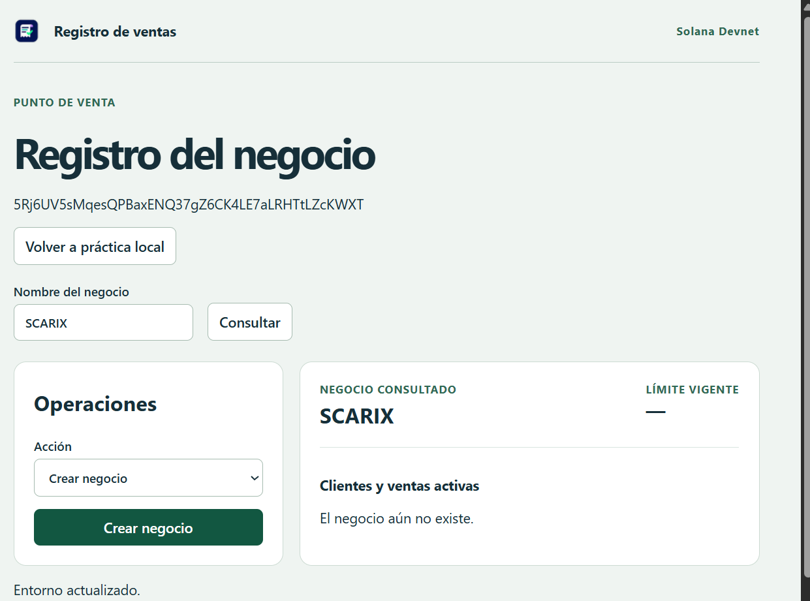

### M02_scarix_creado_10000

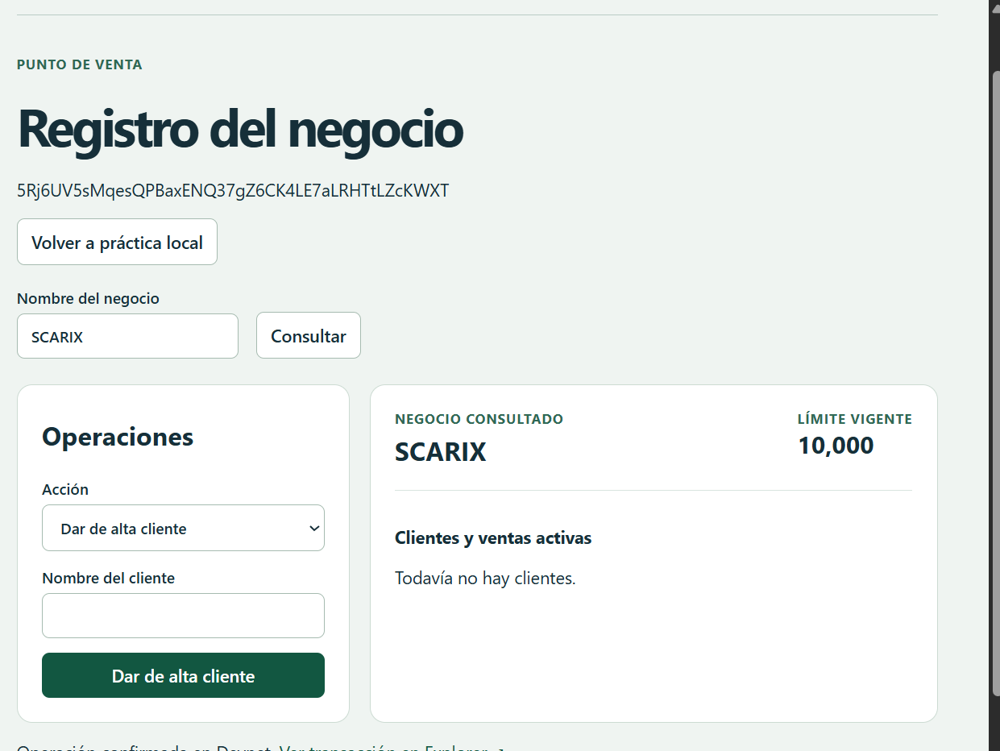

### M03_ana_cliente_1

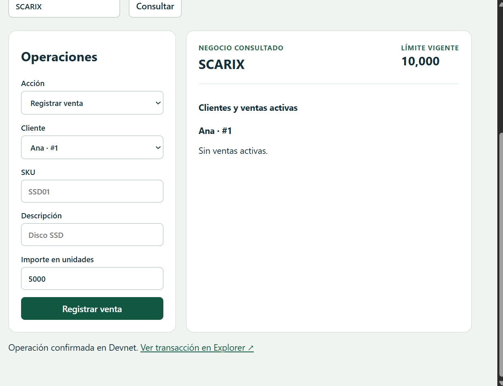

### M03_transaccion_explorer_finalized

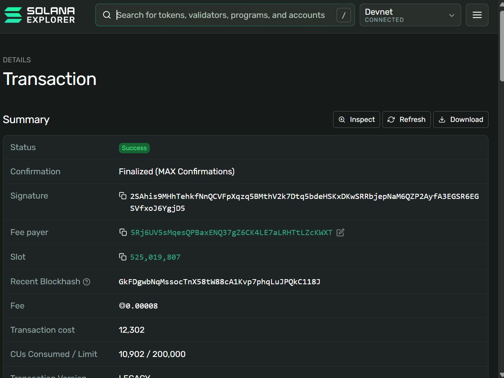

### M04_venta_ssd01_5000

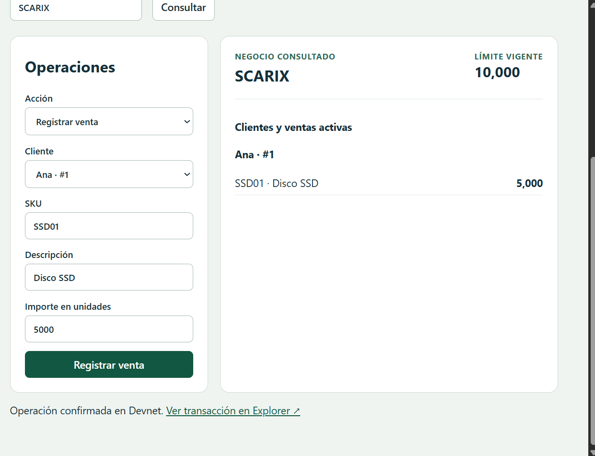

### M05_limite_reducido_5000

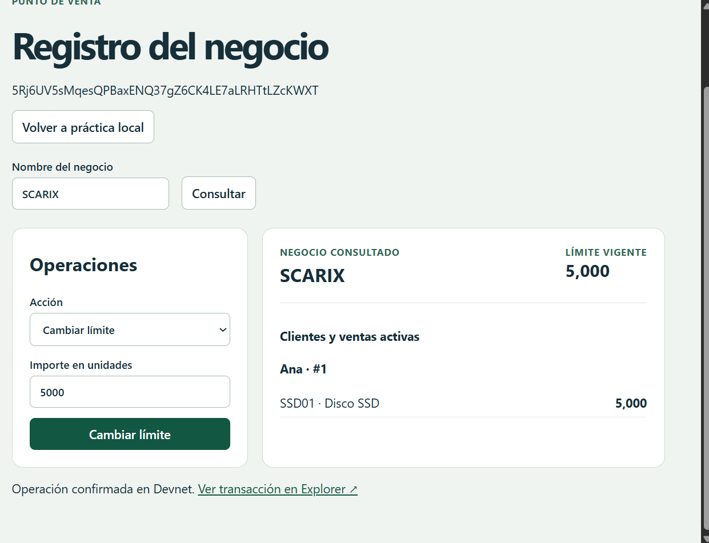

### M06_correcion_5001_no_aplicada

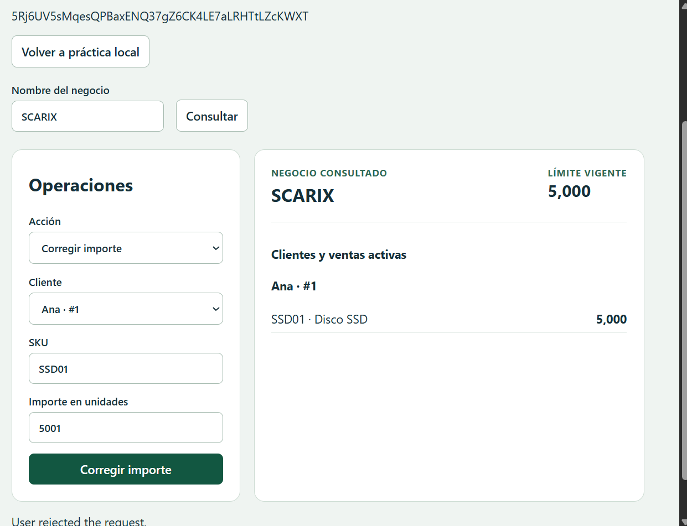

### M06_rechazo_simulacion_phantom

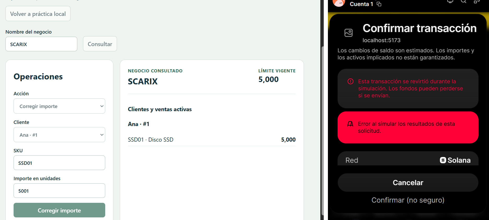

### M07_phantom_devolucion_rent

### M07_venta_devuelta

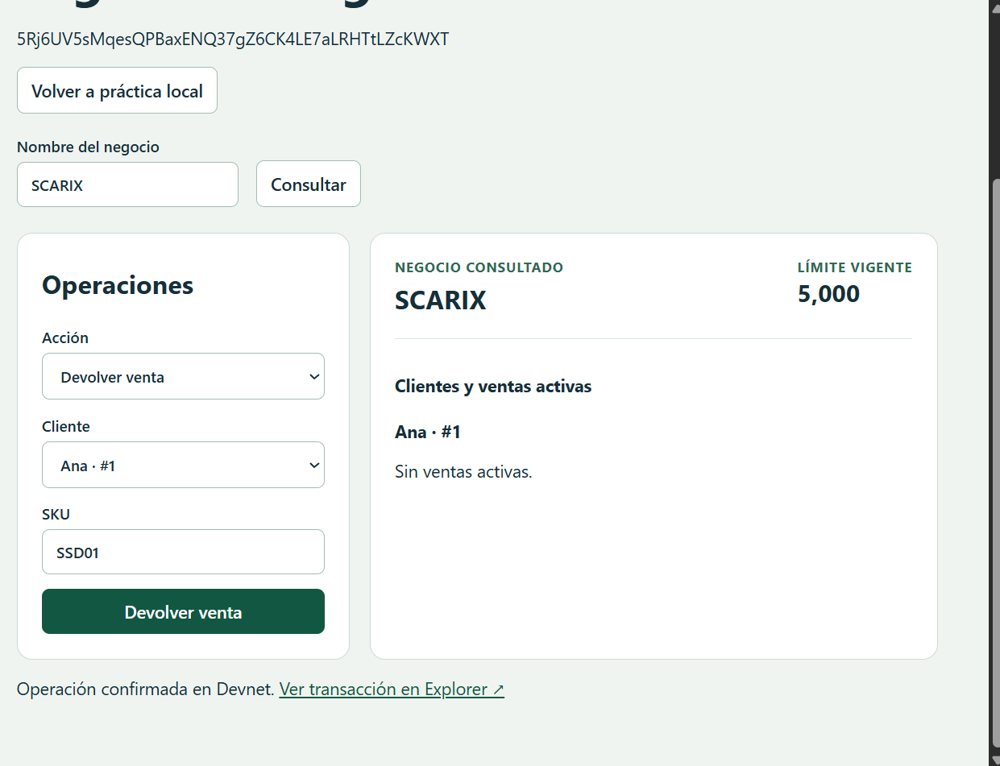

### M08_cliente_dado_de_baja

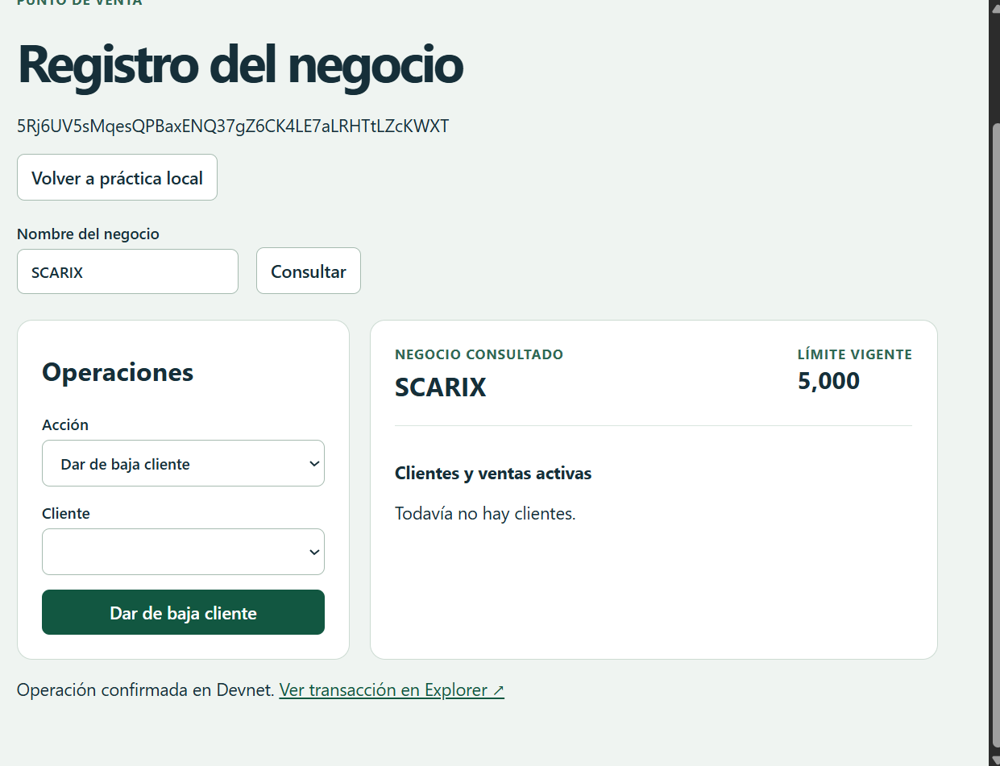

### M08_phantom_baja_rent

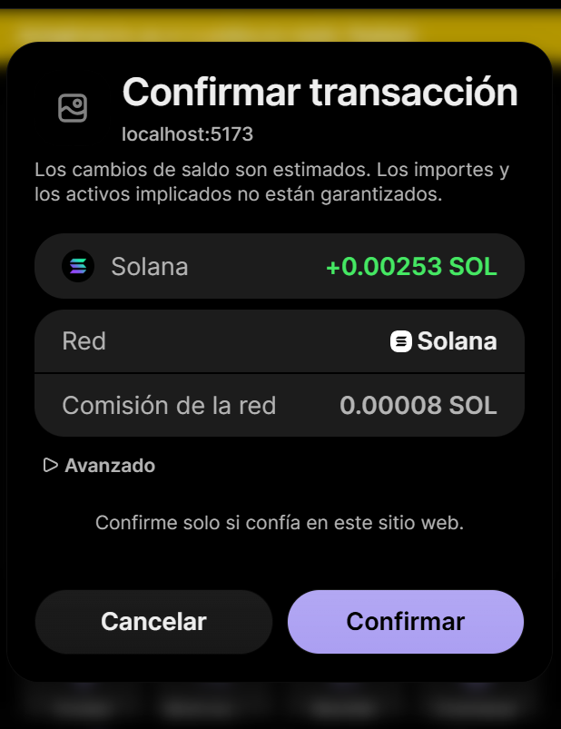

