# Anexo: capturas de pruebas manuales en Solana Devnet

Capturas originales aportadas en la revisión del 22 de noviembre de 2026. Todas están **recortadas sin alterar su contenido** para eliminar pestañas, barras del navegador y secciones de Phantom que no constituyen evidencia. Los recortes tienen resolución nativa; no se han fabricado saldos, firmas, errores ni resultados.

> La evidencia visual muestra resultados de la interfaz. Los enlaces transaccionales verificables están en [`evidencias/Prueba1795336274564.md`](../Prueba1795336274564.md), que documenta un **recorrido automatizado distinto**. El rechazo manual M06 es un fallo de simulación genérico, no una firma fallida en la cadena.

## M01 — Phantom conectado a Solana Devnet

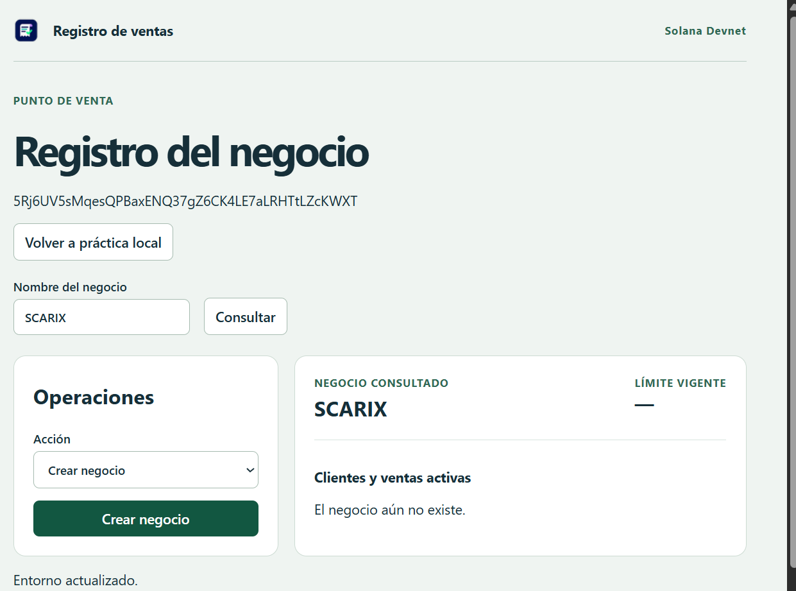

## M02 — Creación de SCARIX, límite inicial 10 000

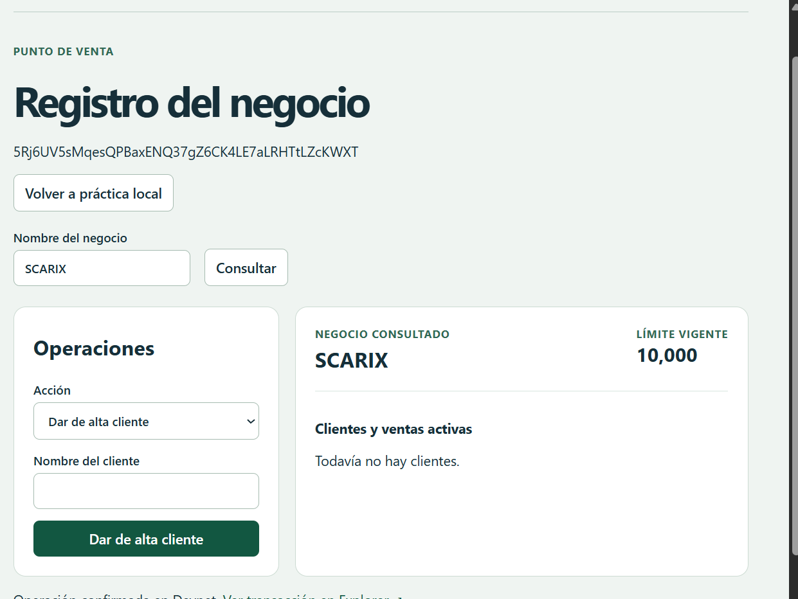

## M03 — Alta de Ana e inspección en Explorer

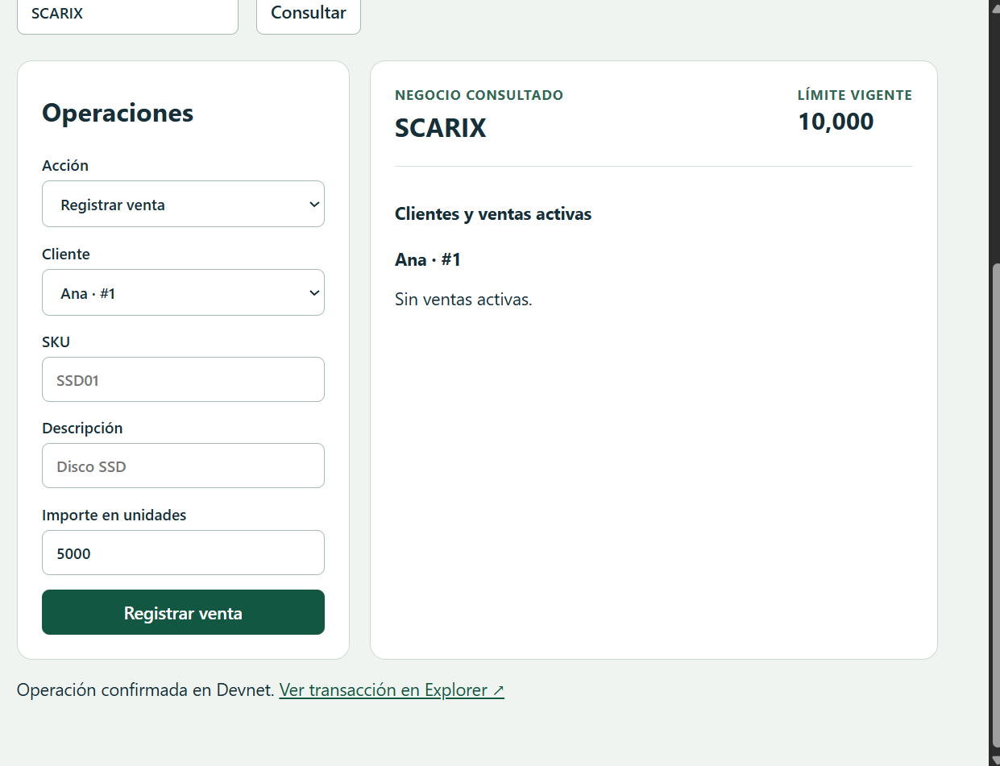

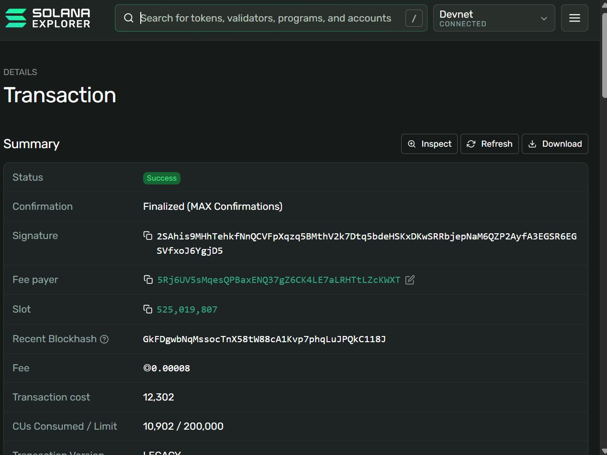

## M04 — Venta SSD01, Disco SSD, 5 000 unidades

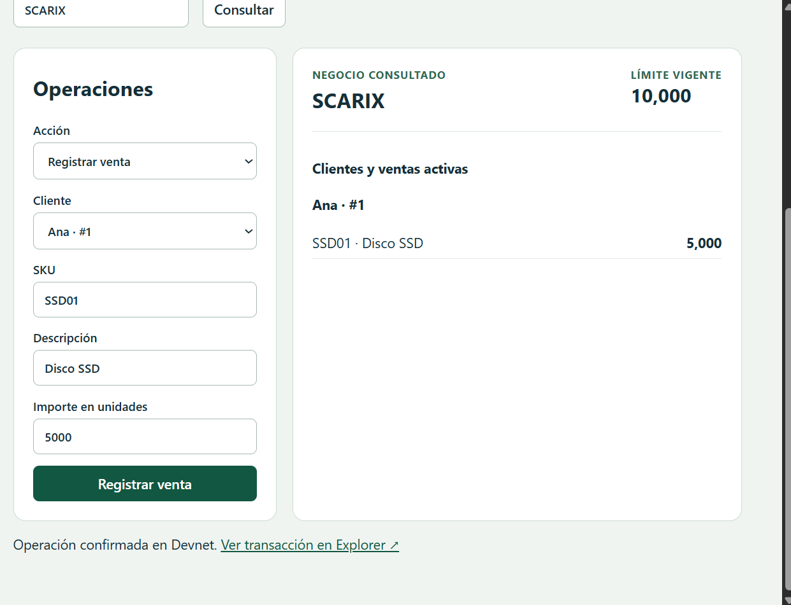

## M05 — Reducir límite a 5 000 conservando la venta

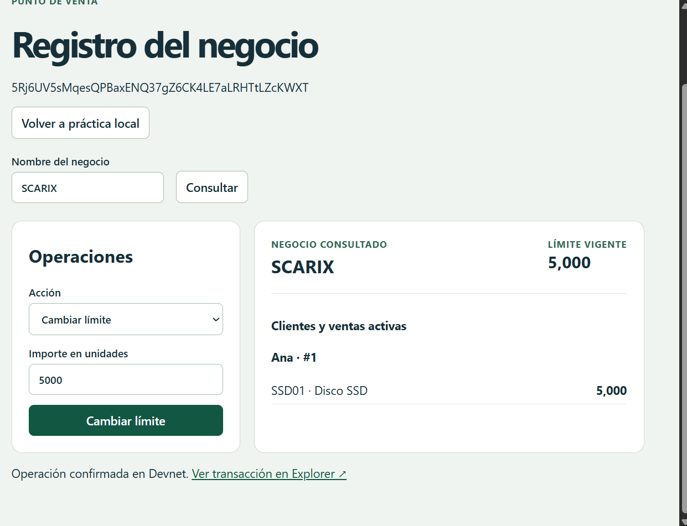

## M06 — Intento rechazado de corrección a 5 001

La captura conserva **simultáneamente** la operación 5 001 solicitada y el aviso de Phantom de simulación fallida. El usuario canceló la operación, que **no se confirmó en la cadena**. La lectura posterior conservó la venta en 5 000.

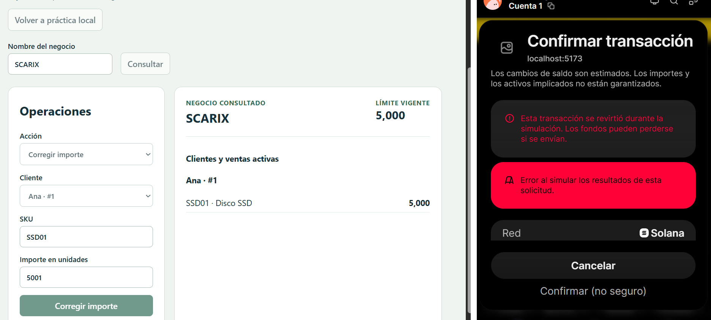

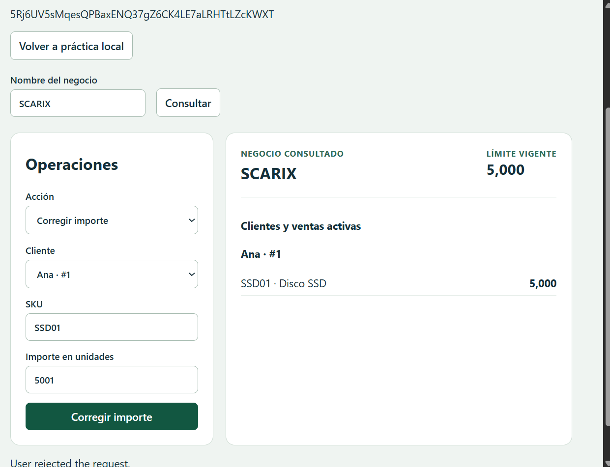

## M07 — Devolución de la venta SSD01

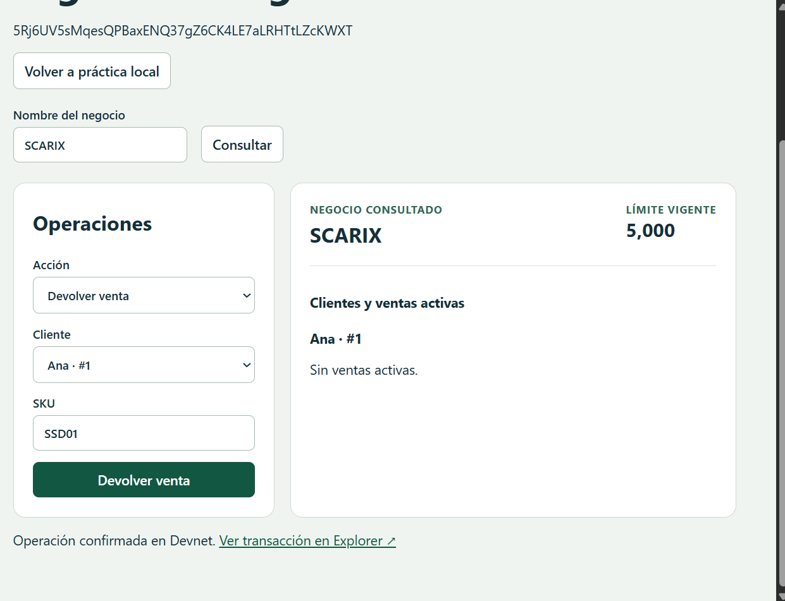

## M08 — Baja de Ana sin ventas activas

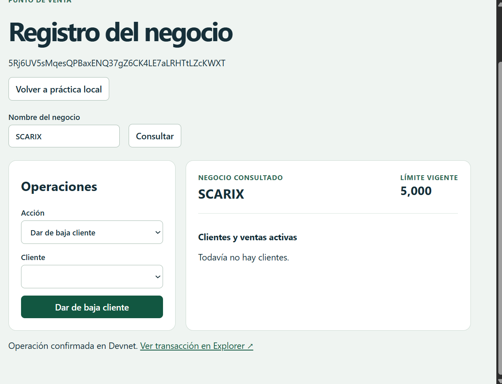

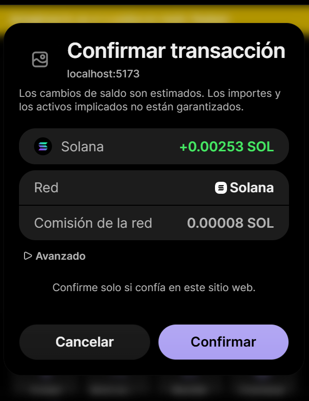

## Resultado

SCARIX sigue disponible en Devnet con límite de **5 000**, sin clientes ni ventas activas. La prueba automatizada adicional validó explícitamente `MontoExcedeTope`, las autoridades y las PDAs por separado.
